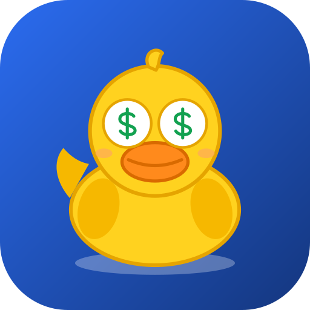

**🌐 Live app: [https://budget-up.budget-up.workers.dev](https://budget-up.budget-up.workers.dev)**

<p align="center"></p>

# Budget Up

A shared household budget for you and your partner, in **Israeli shekels (₪)**. Installable on your phone as an app (PWA), with the same data on every device.

- ➕ One-tap **Income** and **Expense** entry (category, amount, comment)
- 👥 **Share** a budget with a link; keep separate budgets ("Family", "Parents") under one login
- 📊 **View** by month or year, by category, with subcategories that roll up (Food ₪1,000 → Shopping ₪800, Snacks ₪200)
- 🤲 **מעשר (Maaser)** — 10% of income over the last 12 months, "Give" button, extra giving is remembered
- 🔁 **Default** monthly expenses/income (rent, bills, salary) added automatically
- ✏️ Fix or delete mistaken entries
- ✉️ **Monthly summary email** on the 1st
- 🦆 Home-screen icon: a rubber duck with `$` eyes

Full details are in [`budget-spec.md`](budget-spec.md).

## Install on your phone

1. Open the live link above in **Chrome (Android)** or **Safari (iPhone)**.
2. Android: menu → **Install app** / **Add to Home screen**. iPhone: Share → **Add to Home Screen**.
3. Create an account (username + password). You stay signed in on that device.
4. To add your partner: **☰ → Settings → Sharing & budgets → Invite someone**, and send them the link.

## How it's built

| Piece | Tech |
|---|---|
| App | Vanilla JS ES modules, no build step (`public/`) — PWA with manifest + service worker |
| API | Cloudflare Worker (`src/worker.js`) |
| Database | Cloudflare D1 (SQLite), migrations in `migrations/` |
| Monthly job | Daily Worker cron (`0 5 * * *`) — adds default items on the 1st and emails each user on their chosen day |
| Email | Gmail SMTP via `worker-mailer` (Resend also supported) — optional until configured |

Shared logic (category roll-ups, maaser maths, formatting) lives in `public/js/aggregate.js` and is used by both the app and the Worker, with unit tests in `test/`.

## Run it locally

```bash
npm install
npm run db:local        # create the local D1 database
npm run dev             # http://127.0.0.1:8787
npm test                # unit tests
node scripts/smoke.mjs  # end-to-end API test against the running dev server
```

## Deploy (Cloudflare)

```bash
npx wrangler login
npx wrangler d1 create budget-up          # copy the database_id into wrangler.jsonc
npm run db:remote                          # apply migrations
npm run deploy
```

### Monthly summary emails

Emails go out through **Gmail SMTP** (no domain needed). Without it the app works normally and just skips sending.

1. In your Google account turn on 2-Step Verification, then create an **App password** (Google Account → Security → App passwords).
2. Store both as Worker secrets:

```bash
npx wrangler secret put GMAIL_USER           # your full Gmail address
npx wrangler secret put GMAIL_APP_PASSWORD   # the 16-character app password
```

**Settings → Account → "Send me last month's summary now"** sends a test. Each user picks their send day there (default: the 1st; short months use their last day). [Resend](https://resend.com) is also supported via `RESEND_API_KEY` if you have a verified domain.

## Regenerate the icons

```bash
npm run icons
```

## Project layout

```
public/          the PWA (index.html, css/, js/, icons/, manifest, sw.js)
src/             Worker: API, auth, monthly email
migrations/      D1 schema
scripts/         icon generator, API smoke test
test/            unit tests
budget-spec.md   product spec
```
